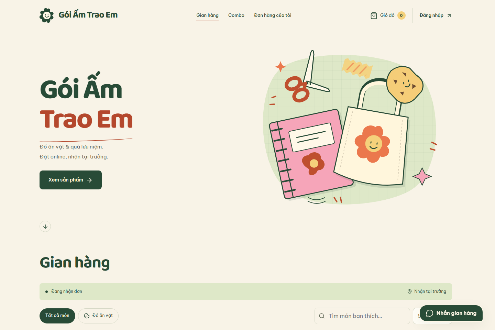
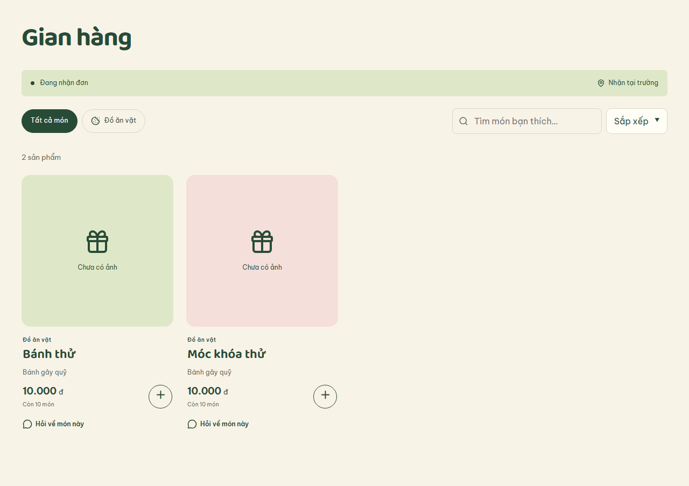
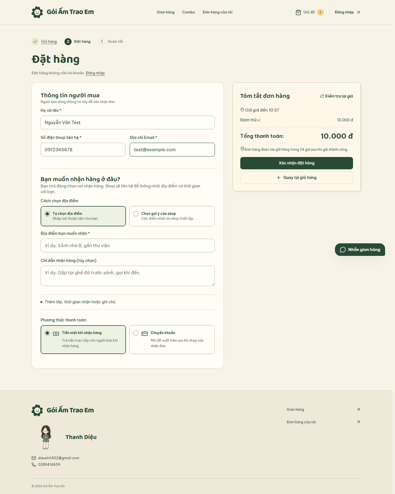
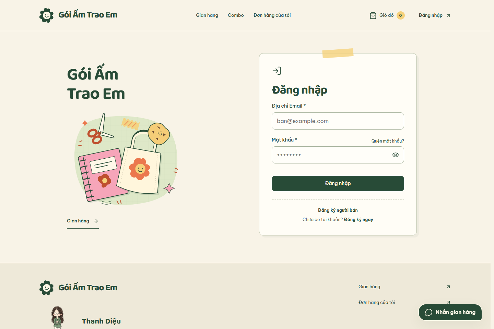
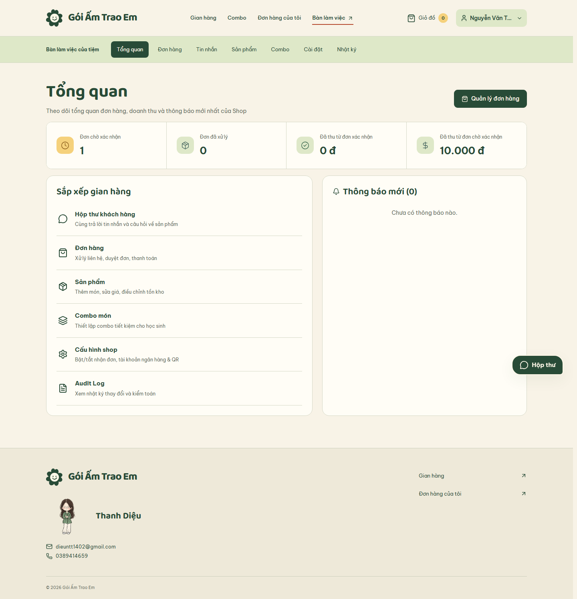
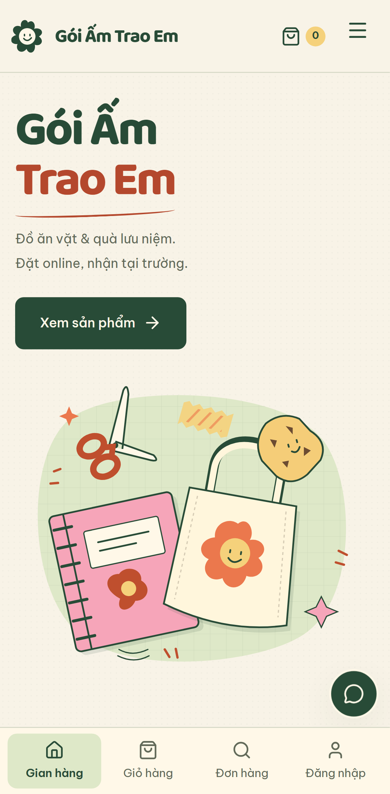
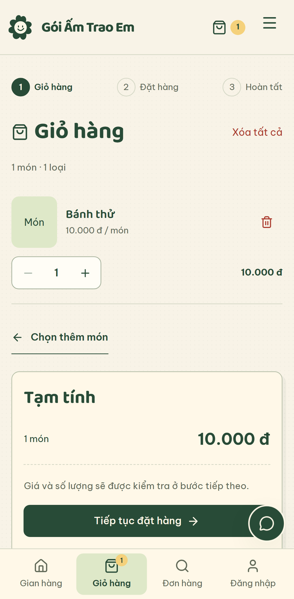
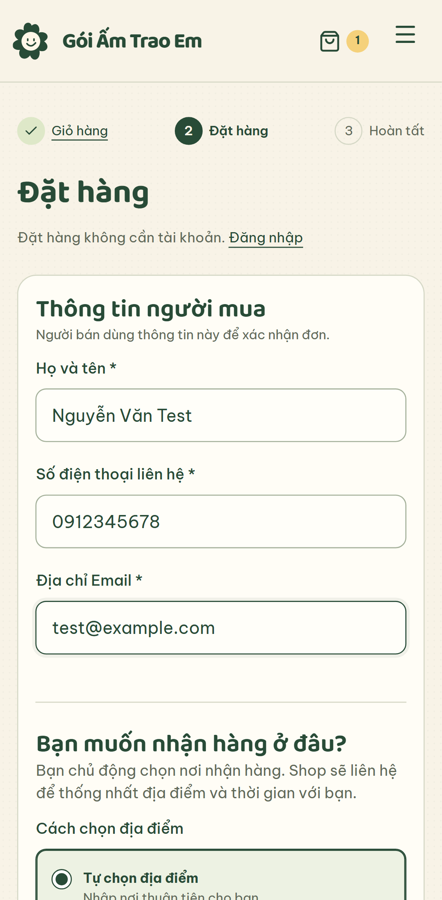

<div align="center">

# 🌼 Gói Ấm Trao Em

**Gian hàng gây quỹ · Đồ ăn vặt & quà lưu niệm · Đặt online, nhận tại trường**

Một trải nghiệm mua sắm mang sắc màu của giấy, những món quà nhỏ và sự ấm áp.


[Giao diện](#giao-dien) · [Thiết kế](#thiet-ke) · [Trải nghiệm](#trai-nghiem) · [Chạy local](#chay-local) · [Kiểm thử](#kiem-thu)



*Trang chủ — nhận diện thương hiệu và lời mời khám phá gian hàng.*

</div>

> Ảnh được chụp trực tiếp từ giao diện chạy local bằng Playwright, sử dụng dữ liệu mẫu cô lập. Tên sản phẩm, người mua và số liệu trong ảnh là dữ liệu kiểm thử; các ảnh không phản ánh đơn hàng hay doanh thu thực tế.

<a id="giao-dien"></a>

## 🖼 Giao diện · UI showcase

### Gian hàng — chọn món thật rõ ràng



Danh mục, ô tìm kiếm và lựa chọn sắp xếp đặt ngay trước danh sách sản phẩm. Mỗi thẻ hiển thị tên món, mô tả, giá, số lượng còn lại và nút thêm vào giỏ. Ảnh mẫu giữ đúng trạng thái **“Chưa có ảnh”** của sản phẩm trong fixture.

### Đặt hàng — biểu mẫu bên cạnh tờ hóa đơn



Bố cục hai cột tách thông tin người nhận và tóm tắt đơn hàng. Thanh tiến trình giúp người mua biết mình đang ở bước nào; điểm nhận hàng và phương thức thanh toán được trình bày thành lựa chọn cụ thể.

### Tài khoản — đồng nhất từ trang chủ đến biểu mẫu



Trang đăng nhập kết hợp mảng minh họa và biểu mẫu gọn, giữ nguyên màu sắc, nét bo tròn và kiểu chữ của gian hàng. Trên điện thoại, biểu mẫu được ưu tiên để người dùng vào tài khoản nhanh hơn.

### Người bán — không gian quản lý cùng một nhận diện



Dashboard đưa các chỉ số đơn hàng và tiền đã thu lên trước, rồi đến lối tắt quản lý và thông báo. Sản phẩm, combo, đơn hàng, hộp thư, cấu hình shop và nhật ký đều có điểm truy cập rõ ràng.

### Mobile — từ khám phá đến đặt hàng

<table>
  <tr>
    <th width="33%">Trang chủ</th>
    <th width="33%">Giỏ hàng</th>
    <th width="33%">Đặt hàng</th>
  </tr>
  <tr>
    <td valign="top"></td>
    <td valign="top"></td>
    <td valign="top"></td>
  </tr>
</table>

Điều hướng dưới màn hình đưa **gian hàng, giỏ hàng, đơn hàng và tài khoản** vào tầm tay. Các cột trên desktop chuyển thành nội dung dọc; phần tóm tắt đơn nằm trong luồng trang để đọc và thao tác khi cuộn.

<a id="thiet-ke"></a>

## 🎨 Ngôn ngữ thiết kế

### Ý tưởng: một gian hàng thủ công trong trường

**Gói Ấm Trao Em** sử dụng chất liệu thị giác của giấy và đồ thủ công: nền kem có họa tiết chấm nhẹ, mực xanh rừng, điểm nhấn cam đất, mảng giấy pastel và minh họa cắt giấy. Biểu tượng bông hoa có gương mặt tạo dấu hiệu nhận diện xuyên suốt thanh điều hướng, trang tài khoản và chân trang.

Tiêu đề lớn kết hợp khoảng thở rộng giúp trang chủ có cá tính; các màn hình mua hàng và quản lý giữ thông tin gọn, dễ đọc và tập trung vào thao tác.

### Bảng màu


| Màu | Mã màu | Vai trò trong giao diện |
| --- | --- | --- |
| 🌿 Xanh rừng | `#284B37` | Chữ chính, nhận diện, nút hành động chính |
| 📜 Giấy kem | `#F8F3E7` | Nền trang, tạo cảm giác ấm và mềm |
| 🧾 Giấy hóa đơn | `#FFF8E8` | Bề mặt giấy và vùng minh họa |
| 🧱 Cam đất | `#B4482D` | Điểm nhấn và viền focus |
| 🌸 Hồng pastel | `#F4AFC1` | Chi tiết trang trí, mảng giấy |
| ☀️ Vàng ấm | `#F5D17B` | Chi tiết minh họa và điểm nhấn |
| 🍃 Xanh sage | `#DEE8C8` | Mảng nền bổ trợ |

### Chữ, hình khối và bố cục

| Thành phần | Lựa chọn thiết kế | Mục đích |
| --- | --- | --- |
| Tiêu đề | **Baloo 2 Variable**, nét tròn, đậm | Tạo cảm giác gần gũi và nhận diện riêng |
| Nội dung | **Be Vietnam Pro**, hỗ trợ tiếng Việt | Đọc tên món, thông tin người mua và hướng dẫn rõ ràng |
| Font | Đóng gói cùng ứng dụng qua Fontsource | Phục vụ font từ ứng dụng |
| Bo góc | Các mức `10 / 18 / 28px` | Đồng nhất nút, biểu mẫu và bề mặt nội dung |
| Bề mặt | Viền mảnh, bóng nhẹ, nền giấy | Phân nhóm thông tin và giữ cảm giác nhẹ nhàng |
| Biểu tượng | Lucide và minh họa SVG riêng | Hỗ trợ hiểu thao tác và giữ cá tính thương hiệu |
| Responsive | Hai cột trên desktop, ưu tiên một cột trên mobile | Phù hợp thao tác bằng chuột và chạm |

Các token đang dùng nằm trong [workshop.css](frontend/src/workshop.css). Xem thêm [định hướng thiết kế](design-system/shop-for-charity/MASTER.md) và [ghi chú UX](design-system/shop-for-charity/UX.md).

### Chuyển động và khả năng tiếp cận

- Lời chào thương hiệu ngắn khi vào trang chủ; người dùng có thể bỏ qua bằng thao tác.
- Hiệu ứng xuất hiện khi cuộn, phản hồi nút bấm, hover ảnh và thay đổi số lượng giỏ hàng giúp nhận biết hành động.
- Tôn trọng `prefers-reduced-motion`, hiển thị nội dung ngay khi người dùng chọn giảm chuyển động.
- Có viền focus, liên kết bỏ qua điều hướng, nhãn biểu mẫu, điều khiển bằng bàn phím và quản lý focus trong modal.
- Trạng thái đơn có nhãn chữ; thông báo thành công, lỗi và hết hàng được thể hiện trực tiếp trong giao diện.

<a id="trai-nghiem"></a>

## 🧭 Trải nghiệm người dùng

**Chọn món → Giỏ hàng → Điền thông tin & chọn điểm nhận → Đặt hàng → Theo dõi đơn → Nhận tại điểm hẹn.**

| Chặng | Cách giao diện hỗ trợ |
| --- | --- |
| Khám phá | Tìm kiếm có debounce, lọc danh mục, sắp xếp, đếm kết quả và xóa bộ lọc |
| Chọn món | Xem giá và tồn kho; chọn số lượng; thêm sản phẩm hoặc combo; có phản hồi sau thao tác |
| Giỏ hàng | Điều chỉnh số lượng, xóa món, hoàn tác xóa và xem tổng tiền dự kiến |
| Đặt hàng | Khách có thể đặt mà không cần tài khoản; báo lỗi từng trường; giữ nội dung đã nhập khi cập nhật báo giá |
| Nhận hàng | Chọn điểm của shop hoặc đề xuất điểm nhận; người bán liên hệ xác nhận lịch nhận |
| Thanh toán | Chọn tiền mặt hoặc chuyển khoản; người bán đối soát khoản tiền thực nhận |
| Theo dõi | Tài khoản xem lịch sử; khách tra cứu bằng mã đơn và thông tin truy cập được cấp |
| Hỗ trợ | Khách đã đăng nhập có thể nhắn tin và hỏi về sản phẩm trong hộp thư |
| Quản lý | Người bán quản lý sản phẩm, combo, tồn kho, đơn hàng, thanh toán, thông báo và cấu hình |

Thông báo đã chuyển khoản của người mua là một bước báo cáo. Việc xác nhận đã nhận tiền do người bán thực hiện; web không tự chuyển tiền qua ngân hàng.

## 🛠 Công nghệ và cấu trúc

| Lớp | Công nghệ |
| --- | --- |
| Frontend | React 19, TypeScript, Vite 8, React Router, CSS |
| Dữ liệu & biểu mẫu | TanStack Query, React Hook Form, Zod |
| Backend hiện tại | Node.js 24, Express |
| Lưu trữ & xác thực | PostgreSQL, Supabase Auth / Storage / Realtime |
| Email xác nhận | Resend khi đã cấu hình |
| Kiểm thử | Node test runner, PostgreSQL embedded, Playwright |
| Triển khai | Cấu hình Vercel trong repository |

```text
ShopForCharity/
├── frontend/
│   ├── src/components/       # Điều hướng, trạng thái, lịch, minh họa
│   ├── src/features/         # Catalog, cart, checkout, orders, auth, seller, chat
│   ├── src/workshop.css      # Màu, font và phong cách giao diện
│   ├── e2e/                  # Kiểm thử luồng desktop và mobile
│   └── scripts/readme/       # Chụp lại ảnh UI bằng fixture
├── backend/                  # API Node.js, nghiệp vụ, migration, kiểm thử
├── design-system/            # Định hướng thiết kế và UX
├── docs/readme/images/       # Ảnh giao diện hiển thị trong README
├── docs/                     # API, tích hợp, vận hành và báo cáo kiểm thử
└── deployment/               # Script và kiểm thử cấu hình triển khai
```

Backend Java/Spring Boot cũ vẫn được giữ trong repository. Các lệnh bên dưới chạy backend **Node.js** hiện tại.

<a id="chay-local"></a>

## 🚀 Chạy dự án local

Yêu cầu **Node.js 24**, npm và môi trường PostgreSQL/Supabase đã cấu hình nếu muốn chạy toàn bộ tính năng với dữ liệu thật.

Từ root repository, cài dependency theo lockfile của từng ứng dụng:

```powershell
npm.cmd --prefix frontend ci --workspaces=false
npm.cmd --prefix backend ci --workspaces=false
Copy-Item frontend/.env.example frontend/.env.local
Copy-Item backend/.env.example backend/.env
```

Nếu đã có file môi trường riêng, giữ cấu hình hiện tại. Điền giá trị của môi trường phát triển vào các file vừa sao chép:

| File | Cấu hình chính |
| --- | --- |
| `frontend/.env.local` | `VITE_API_BASE_URL=/api/v1`, `VITE_SUPABASE_URL`, `VITE_SUPABASE_PUBLISHABLE_KEY` |
| `backend/.env` | Kết nối PostgreSQL, JWT, Storage, CORS và hai khóa độc lập cho phiên khách / idempotency |
| Email tùy chọn | `RESEND_API_KEY`, `ORDER_EMAIL_FROM` ở backend |

Frontend chỉ dùng publishable/anon key. Khóa backend và mật khẩu database được đặt trong môi trường backend. Xem [hướng dẫn backend](backend/README.md) để cấu hình database, quyền runtime và migration; migration cần credential riêng và chạy trước khi sử dụng API.

Mở hai terminal tại root:

```powershell
# Terminal 1 — API
npm.cmd run dev:backend

# Terminal 2 — giao diện
npm.cmd run dev:frontend
```

Mở **http://localhost:5173**. Vite chuyển tiếp `/api` đến backend tại **http://localhost:8080**.

Trên Linux/macOS, thay `npm.cmd` bằng `npm`, và dùng `cp` để sao chép file môi trường.

<a id="kiem-thu"></a>

## ✅ Kiểm thử

Chạy tại root repository:

```powershell
# Backend và cấu hình triển khai
npm.cmd test

# TypeScript và bản build frontend
npm.cmd --prefix frontend run build

# Luồng trình duyệt trên desktop và mobile
npm.cmd --prefix frontend run test:e2e
```

Playwright cần browser đã cài. Các bài e2e mặc định dùng API/session fixture cô lập, tự build và khởi động Vite preview local. Kiểm thử tích hợp và dịch vụ thật có cấu hình riêng trong `frontend/`.

<details>
<summary><strong>📸 Chụp lại bộ ảnh README</strong></summary>

Từ root, cài Chromium nếu máy chưa có browser của Playwright, rồi chạy cấu hình chụp ảnh:

```powershell
npm.cmd --prefix frontend exec -- playwright install chromium
npm.cmd --prefix frontend run test:e2e -- --config scripts/readme/playwright.config.ts
```

Nếu đã cài browser ở thư mục riêng, đặt `PLAYWRIGHT_BROWSERS_PATH` trỏ đến thư mục đó trước khi chạy. Bộ chụp ảnh dùng desktop 1440px và thiết bị Pixel 7, giảm chuyển động để ảnh ổn định và ghi PNG vào `docs/readme/images/`.

Script sử dụng chung fixture của e2e, kiểm tra các màn hình đã tải và không có lỗi runtime. Ảnh đặt hàng được chụp trước bước gửi đơn.

</details>

Build và kiểm thử local là các bước kiểm chứng tại máy phát triển. Triển khai Preview cần tạo deployment thành công và kiểm tra URL riêng theo [hướng dẫn triển khai](docs/vercel-deployment.md).

## 📚 Tài liệu liên quan

| Tài liệu | Nội dung |
| --- | --- |
| [Design system](design-system/shop-for-charity/MASTER.md) | Nhận diện, token, bố cục và chuyển động |
| [UX](design-system/shop-for-charity/UX.md) | Hành trình người dùng và cách phục hồi sau lỗi |
| [Frontend](frontend/README.md) | Điểm bắt đầu khi làm việc với giao diện |
| [Backend](backend/README.md) | Cấu hình API, database và nghiệp vụ |
| [OpenAPI](docs/openapi.yaml) | Hợp đồng API |
| [Luồng nhận hàng](docs/customer-pickup-flow.md) | Điểm nhận hàng và lịch hẹn |
| [Chat realtime](docs/chat-realtime.md) | Hộp thư khách hàng và người bán |
| [Email xác nhận](docs/order-confirmation-email.md) | Thiết lập email và retry |
| [Triển khai](docs/vercel-deployment.md) | Cấu hình môi trường và vận hành |

---

<div align="center">

**🌼 Gói Ấm Trao Em** · Một gian hàng nhỏ, được chăm chút từ giao diện đến từng bước nhận hàng.

</div>
